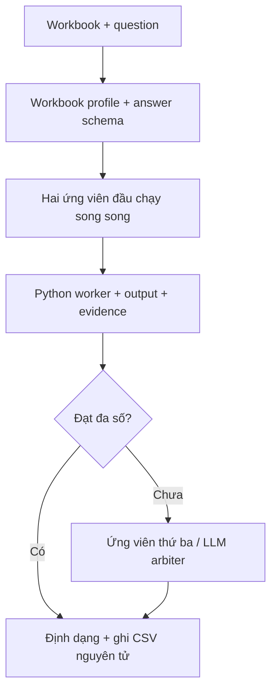

<div align="center">

# SheetReason

### Ask in natural language. Compute with Python. Inspect the evidence.

Hệ thống hỏi đáp trên Excel kết hợp suy luận LLM, thực thi mã và đối chiếu nhiều ứng viên.

   

[Pipeline](#pipeline) · [Thiết kế kỹ thuật](#thiết-kế-kỹ-thuật) · [Chạy dự án](#chạy-dự-án) · [Đầu vào và đầu ra](#đầu-vào-và-đầu-ra) · [Giới hạn](#giới-hạn)

</div>

---

## Bài toán

Một workbook thực tế có thể chứa nhiều sheet, bảng con, tiêu đề nhiều dòng, ô gộp, công thức thiếu giá trị cache và các quy ước số khác nhau. Câu hỏi lại yêu cầu đúng đối tượng, phạm vi tính toán, đơn vị và cách trình bày đáp án.

SheetReason lập hồ sơ cấu trúc workbook, suy luận định dạng đáp án rồi sinh hàm Python để đọc ô nguồn và tính toán. Nhiều lời giải được đối chiếu trước khi ghi kết quả. Mỗi lần thực thi giữ lại mã và stdout để người phát triển lần theo cách đáp án được tạo ra.

## Pipeline



1. **Hiểu cấu trúc:** trích thông tin sheet, ô gộp, header, kiểu dữ liệu, style và các vùng bảng liên quan đến câu hỏi.
2. **Chốt hợp đồng đáp án:** schema mô tả số, nhãn, boolean, ngày hoặc kết quả ghép; tách yêu cầu định dạng khỏi phép tính.
3. **Sinh và chạy lời giải:** LLM tạo `solve(file_path)`; worker thực thi, thu kết quả và bằng chứng. Khi lỗi kiểm tra, ứng viên có thể được sửa mã.
4. **Đối chiếu:** mặc định tối đa ba ứng viên; chọn đa số trên chuỗi đã định dạng. Khi nhiều ứng viên hợp lệ bất đồng, LLM arbiter đối chiếu mã và bằng chứng.
5. **Xuất kết quả:** cập nhật CSV sau mỗi câu; ghi log/chẩn đoán riêng để kiểm tra lại.

Nếu chỉ một ứng viên hợp lệ còn lại, implementation có nhánh sử dụng ứng viên đó. Khi không có đáp án được chấp nhận, CSV ghi `UNVALUE`. Cơ chế đa số và trọng tài giúp đối chiếu kết quả nhưng vẫn cần đánh giá độ chính xác trên dữ liệu độc lập.

## Thiết kế kỹ thuật

| Thành phần | Cách triển khai | Giá trị |
| --- | --- | --- |
| Workbook profiler | Giữ tọa độ ô, ô gộp, header ghép, công thức chưa giải được, style và bảng con. | Đưa ngữ cảnh cấu trúc vào bước suy luận. |
| Typed answer schema | Validate JSON schema; định dạng số bằng `Decimal` và `ROUND_HALF_UP`. | Tách tính toán khỏi precision, dấu phân cách và nhãn cần trả về. |
| Executable solver | Chạy Python trong tiến trình con, thu stdout, kiểm tra lỗi và sửa mã có giới hạn. | Kết quả có dấu vết thực thi để chẩn đoán. |
| Ensemble + arbiter | Hai ứng viên đầu song song, dừng sớm khi đủ đa số; trọng tài khi cần. | Phân bổ thêm lượt suy luận cho trường hợp bất đồng. |
| Checkpoint đầu ra | `fsync` + `os.replace`, sau đó validate CSV độc lập. | Giảm nguy cơ file kết quả bị ghi dở và kiểm tra cấu trúc ID. |

Các điểm đọc mã chính trong [excelqa.py](excelqa.py): `profile_workbook`, `infer_answer_format`, `execute_solver_code`, `solve_query`, `write_submission`. Điểm vào sáu tham số là [main.py](main.py); bộ kiểm tra CSV nằm tại [scripts/validate_submission.py](scripts/validate_submission.py).

### Ngân sách mặc định

| Hạng mục | Giới hạn triển khai |
| --- | --- |
| Ngữ cảnh workbook | 16.000 ký tự, ngân sách mềm; worker vẫn có thể đọc workbook đầy đủ. |
| Ứng viên mỗi câu | 3; hai ứng viên đầu song song. |
| Sửa mã mỗi ứng viên | Tối đa 2 lần. |
| Mỗi lần chạy worker | Timeout 60 giây. |
| HTTP | Tối đa 5 lần thử, timeout 60 giây/lần. |
| Completion của solver | Bắt đầu 4.096 token, tăng tối đa 8.192 khi bị cắt. |
| Câu hỏi xử lý đồng thời | Tối đa 6, có xét CPU affinity/quota. |

Phí được cộng từ `usage.cost`; khi thiếu dữ liệu phí, báo `unknown`. Các giới hạn trên chưa tạo thành hard cap chi phí hoặc deadline cho toàn bộ chương trình.

## Chạy dự án

**Môi trường tham chiếu:** Python 3.11, CPU. Backend LLM được gọi qua OpenRouter; model và endpoint được truyền lúc chạy. Repo không kèm API key hoặc workbook đánh giá.

### 1. Cài đặt

```powershell
git clone https://github.com/VPhunggggg/sheetreason-excel-qa.git
cd sheetreason-excel-qa
py -3.11 -m venv .venv
.\.venv\Scripts\python.exe -m pip install -r requirements.txt
```

Linux/macOS: tạo môi trường bằng `python3.11 -m venv .venv`, kích hoạt bằng `source .venv/bin/activate`, sau đó cài `requirements.txt`.

### 2. Chuẩn bị dữ liệu

```text
input/
  queries.json
  xlsx_files/
    demo.xlsx
output/
```

Tạo workbook và `queries.json` theo [ví dụ bên dưới](#đầu-vào-và-đầu-ra). Thư mục input không cần có tên cố định; mỗi workbook được định vị trong `--xlsx-dir`.

### 3. Chạy trên Windows PowerShell

Thay các placeholder bằng thông tin OpenRouter của môi trường chạy:

```powershell
.\.venv\Scripts\python.exe -X utf8 main.py `
  --xlsx-dir .\input\xlsx_files `
  --queries .\input\queries.json `
  --output .\output\submission.csv `
  --openrouter-key "<API_KEY>" `
  --openrouter-model "<MODEL_ID>" `
  --openrouter-base-url "https://openrouter.ai/api/v1"
```

Chương trình nhận đủ sáu tham số trên, có thể dùng đường dẫn tuyệt đối hoặc tương đối. Mỗi lần chạy cần mạng và hạn mức API của provider.

<details>
<summary><strong>Chạy bằng Docker (Linux amd64)</strong></summary>

Tại thư mục gốc repo, sau khi đã chuẩn bị `input/` và `output/`:

```bash
docker build --platform linux/amd64 -t sheetreason:local .
docker run --rm --platform linux/amd64 --cpus 6 --memory 12g \
  -v "$PWD/input:/input:ro" \
  -v "$PWD/output:/output:rw" \
  sheetreason:local \
  --xlsx-dir /input/xlsx_files \
  --queries /input/queries.json \
  --output /output/submission.csv \
  --openrouter-key "<API_KEY>" \
  --openrouter-model "<MODEL_ID>" \
  --openrouter-base-url "https://openrouter.ai/api/v1"
```

Ví dụ này dùng Bash. Dockerfile cài dependency trong ảnh, giới hạn thư viện số về một luồng và đặt `main.py` làm entrypoint.

</details>

## Đầu vào và đầu ra

**Ví dụ minh họa:** tự tạo `demo.xlsx` với bảng sau, đặt ở sheet đầu tiên:

| Product | Revenue |
| --- | ---: |
| Alpha | 10 |
| Beta | 15.275 |

`queries.json` là mảng object gồm `id`, `file_name`, `query`:

```json
[
  {
    "id": 1,
    "file_name": "demo.xlsx",
    "query": "What is the total revenue? Return a number with exactly two decimal places."
  }
]
```

CSV kỳ vọng cho ví dụ này:

```csv
id,answer
1,25.28
```

| Tệp đầu ra | Vai trò |
| --- | --- |
| `submission.csv` | Hai cột `id,answer`; ID sắp tăng dần và xuất hiện đúng một lần. |
| `submission.debug.log` | Mã ứng viên, đáp án và bằng chứng stdout để truy vết. |
| `submission.errors.json` | Chi tiết câu chưa giải được; được tạo khi cần. |

Dấu phẩy trong nhãn được quote theo CSV. Câu chưa giải được dùng `UNVALUE`. Kiểm tra độc lập cấu trúc kết quả mà không gọi LLM:

```bash
python scripts/validate_submission.py --queries input/queries.json --submission output/submission.csv
```

## Kiểm chứng và đóng gói

Smoke check offline trên workbook tự tạo đã kiểm tra ô gộp, style, công thức đơn giản, thực thi worker, voting, làm tròn và thứ tự CSV với LLM giả lập. Bộ test hồi quy và dữ liệu public/hidden được nhắc trong tài liệu bản nộp gốc không có trong repo; README này không dùng các kết quả đó làm benchmark.

Dự án giữ tương thích gói nộp **AI2026 Bảng C — AI26C0024**:

```bash
python scripts/package_submission.py
```

Script tạo `dist/AI26C0024.zip` từ allowlist chín tệp, kiểm tra cú pháp/import, credential, CRC và giới hạn 100 MB. Mã đội được giữ nguyên trong script; tên repo phục vụ giới thiệu và phát triển dự án.

## Giới hạn

- Worker thực thi Python do LLM sinh. Tiến trình con và timeout kiểm soát vòng đời thực thi; hiện chưa có sandbox hạn chế quyền filesystem/network của mã đó.
- Sự đồng thuận giữa ứng viên hoặc lựa chọn của arbiter chưa chứng minh đáp án đúng về ngữ nghĩa. Cần tập đánh giá và quy trình đối chiếu ground truth riêng.
- Chất lượng phụ thuộc workbook, cách diễn đạt câu hỏi và model/provider. Công thức phức tạp chưa có cache có thể cần xử lý thêm.
- Log giữ mã và bằng chứng từ ô nguồn; cần quản lý như dữ liệu của workbook. Key truyền qua entrypoint được đăng ký để che trong log, không được ghi vào source hoặc Dockerfile.
- Các kiểm tra offline chưa thay thế đánh giá API thật, chi phí thực tế hoặc kiểm thử container trên tập dữ liệu triển khai.
